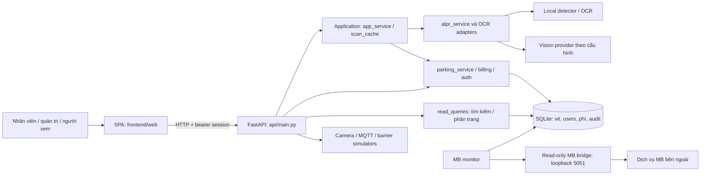
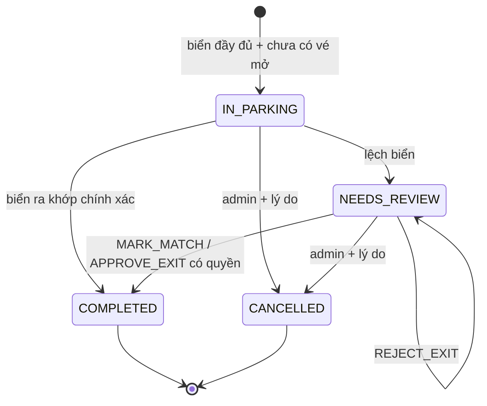
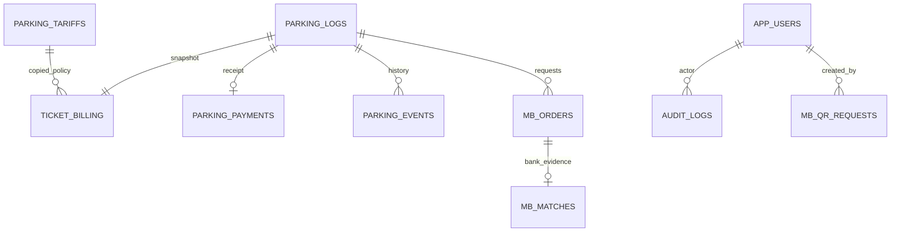
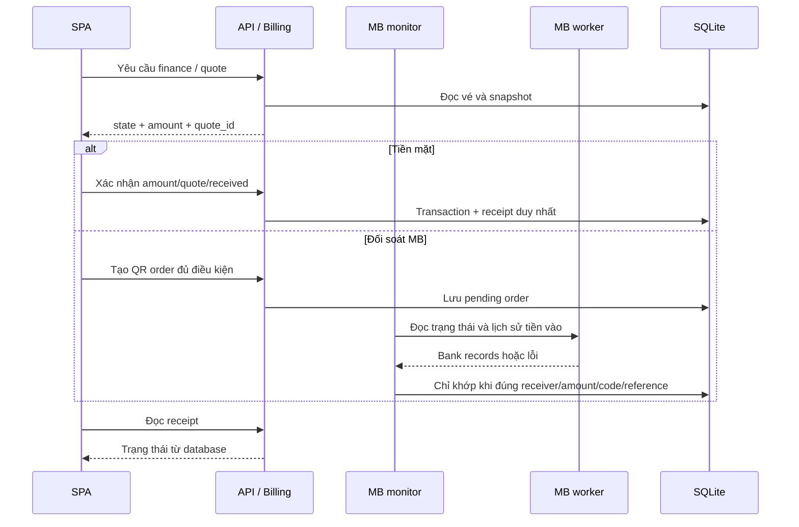

# Kiến trúc ITS Parking

Bản đồ source hiện tại, cập nhật 03/11/2026. Phạm vi: đồ án phần mềm năm 3, phần cứng mô phỏng. Frontend là SPA HTML/CSS/JavaScript được FastAPI phục vụ; Streamlit chỉ còn trong tên tương thích của một số hàm/cấu hình và tài liệu lịch sử.



## Ranh giới module

| Lớp | Trách nhiệm | Không nên làm |
|---|---|---|
| `frontend/web` | Nhập liệu, preview ảnh, bản nháp, trạng thái request, accessibility | Quyết định quyền hoặc thu tiền thay server |
| `api` | HTTP/schema, quyền, upload, status code, error sanitization; `web.py` phục vụ shell | Đặt logic phí trong giao diện |
| `backend/app_service.py` | OCR orchestration và xác nhận nghiệp vụ | Tự khẳng định ảnh đúng vì format hợp lệ |
| `backend/parking_service.py` | Transaction lifecycle, identity, review, cancel | Thay B/8 để làm biển khớp |
| `backend/billing.py` | Tariff snapshot, quote, tiền mặt/chuyển khoản do operator ghi nhận | Sửa phí vé cũ theo bảng phí mới |
| `backend/mb_*` | Yêu cầu QR bền vững, đối soát, polling | Chuyển tiền hoặc tự đăng nhập ngân hàng |
| `backend/db.py`, `migrations.py`, `read_queries.py` | Schema, SQL, truy vấn có giới hạn | Trả mọi vé để browser tự tìm |
| `backend/field_evaluation.py` | Hợp đồng ground truth, chống rò split, số đo chọn lọc | Biến kết quả OCR thành ground truth |
| `integrations` | Ranh giới với model/provider/worker và thiết bị mô phỏng | Báo SIMULATED thành CONNECTED vì có URL |

API router và `app.js` còn lớn; các nghiệp vụ dữ liệu đã ở backend, billing/camera/MB UI đã có module riêng. Không cần đổi framework chỉ để tăng số module. Tiếp tục tách theo trách nhiệm khi có chức năng mới, giữ tests bảo vệ contract.

## Trạng thái vé



`COMPLETED` là hoàn tất đối chiếu xe ra, **không đồng nghĩa đã thanh toán** hoặc đã mở barrier thật. Thanh toán là bản ghi riêng và chỉ được ghi khi vé đủ điều kiện. Một biển không thể có hai vé ở IN_PARKING/NEEDS_REVIEW. Kiểm tra rồi ghi trong `BEGIN IMMEDIATE` để tránh hai request cùng vượt kiểm tra.

## Nhận ảnh và xác nhận

```mermaid
sequenceDiagram
    actor O as Nhân viên
    participant W as SPA
    participant A as FastAPI
    participant S as OCR / Scan cache
    participant D as Parking service / SQLite
    O->>W: Chọn/chụp ảnh
    W->>A: POST /ocr
    A->>S: Validate/lưu ảnh rồi nhận dạng
    S-->>A: Candidate + usability + hash/owner token
    A-->>W: Kết quả và cảnh báo
    O->>W: Đối chiếu / sửa / nhập tay
    W->>A: POST /vehicle/entry hoặc exit + token
    A->>S: Kiểm tra owner và hash ảnh
    A->>D: Xác nhận biển trong transaction
    D-->>A: Vé + event + audit
    A-->>W: Kết quả; mismatch vào review
```

Token là cache có hạn trong process, không phải bằng chứng OCR chắc chắn đúng. Ảnh đổi, user đổi, token hết hạn hoặc server restart phải được xử lý theo contract; không gán kết quả cũ cho ảnh mới. Demo ngoại tuyến trả rõ OCR chưa chạy và cho nhập tay, không phát sinh prediction giả.

## Dữ liệu (quan hệ logic)



Sơ đồ mô tả liên hệ nghiệp vụ, không khẳng định tất cả cạnh được khai báo bằng foreign key SQLite. `parking_logs.ticket_id`, `ticket_billing.ticket_id`, `parking_payments.ticket_id` là khóa chính riêng. `qr_token`, `receipt_id` unique; `mb_matches` khóa `(account_no, bank_reference)` chặn dùng lại giao dịch. `policy_json` của vé là snapshot; update bảng phí không cascade vào vé cũ. `app_users.auth_version` buộc phiên cũ mất hiệu lực sau thay đổi quan trọng.

## Thanh toán



Mất kết nối không được đánh dấu đã trả. Model/worker/camera thật là các dependency tùy chọn; không nằm trong đường chạy của bộ test cô lập. Khởi động web không bắt đầu đăng nhập MB.

## Quyết định và giới hạn

- **SPA + FastAPI:** cùng một nguồn quy tắc ở backend, frontend mỏng theo thao tác. Vanilla JS phù hợp quy mô đồ án; cần giữ race guards khi tách module.
- **SQLite:** phù hợp demo đơn máy, hỗ trợ transaction/backup online. Không suy ra khả năng mở rộng nhiều máy từ test nhỏ; cần thêm thử tải trước pilot.
- **Human confirmation:** giảm hậu quả khi OCR sai; chấp nhận thêm thao tác và độ trễ. Accuracy và usability là hai chỉ số khác nhau.
- **Dependency lock theo nền tảng:** tái lập Windows x64/Python 3.14; nền tảng khác cần lock/test riêng.
- **Hai launcher:** `start.bat` dùng cấu hình hiện có trên 8000; `start_demo.bat` cô lập dữ liệu, không tải `.env`, cổng 8001. Cả hai chỉ bind loopback, không seed tài khoản demo vào DB vận hành.
- **Không tự chấm điểm:** `/system/scorecard` và báo cáo mô tả bằng chứng. Điểm học phần do rubric và phần bảo vệ quyết định.

Xem `docs/REQUIREMENTS_TRACEABILITY.md`, `docs/TESTING_AND_REPRODUCIBILITY.md`, `docs/FIELD_BENCHMARK_PROTOCOL.md`, `docs/THIRD_PARTY_AND_CONTRIBUTIONS.md`. Số test chính thức lấy từ báo cáo cùng source hash, không duy trì một con số cứng dễ lỗi thời trong tài liệu kiến trúc.
